# Taller #1: Contenedores

**Universidad Latina de Costa Rica** · Sistemas Operativos II

- **Estudiante:** Marialaura Calderón Herrera
- **Docente:** Carlos Andrés Mendez Rodríguez
- **Sede:** San Pedro, San José
- **Fecha:** noviembre, 2026

---

## 1. ¿Qué es un contenedor?

Un contenedor es una unidad de software que permite ejecutar una aplicación junto con sus dependencias, bibliotecas y configuraciones necesarias. Esto facilita que funcione de la misma manera en diferentes equipos y sistemas operativos, sin necesidad de instalar todos sus componentes directamente en el sistema principal.

Los contenedores utilizan los recursos del sistema operativo del equipo anfitrión, por lo que son más ligeros que las máquinas virtuales tradicionales.

## 2. Diferencias entre LXD y Docker

| Característica | LXD | Docker |
| :--- | :--- | :--- |
| Enfoque principal | Contenedores del sistema | Contenedores de aplicaciones |
| Funcionamiento | Ejecuta un sistema Linux dentro del contenedor | Ejecuta apps y sus dependencias |
| Administración | Permite gestionar contenedores como si fueran máquinas virtuales | Usa imágenes y contenedores para desplegar aplicaciones |
| Uso común | Crear entornos Linux aislados | Desarrollar, probar y desplegar apps |
| Recursos | Comparte el kernel del sistema anfitrión | Comparte el kernel del sistema anfitrión |

## 3. Flujo de la petición

1. El usuario ingresa a la aplicación desde el navegador utilizando `localhost`.
2. HAProxy recibe la petición por el puerto 80 y la distribuye entre los servidores web disponibles.
3. `web1` o `web2` recibe la petición y ejecuta el código PHP correspondiente.
4. PHP establece una conexión con MariaDB para consultar la información de la base de datos.
5. MariaDB devuelve los resultados al servidor web.
6. El servidor procesa la información y envía una respuesta al navegador del usuario.

## 4. Conclusión

La práctica permitió comprender cómo funcionan los contenedores y cómo Docker facilita la ejecución de diferentes servicios de manera independiente. Esta arquitectura permite organizar las aplicaciones, mejorar la distribución de solicitudes y facilitar su administración.

---

## 5. Evidencias

### 5.1 Instalación de Docker y verificación

Post-instalación (`usermod -aG docker`), versión de Docker y Compose, y prueba con `hello-world`.

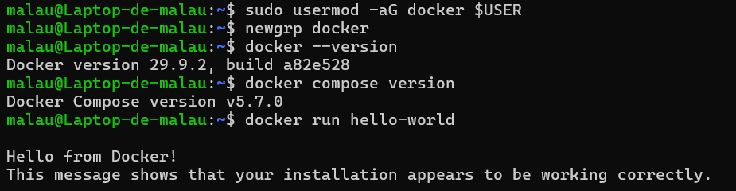

### 5.2 Descompresión del proyecto

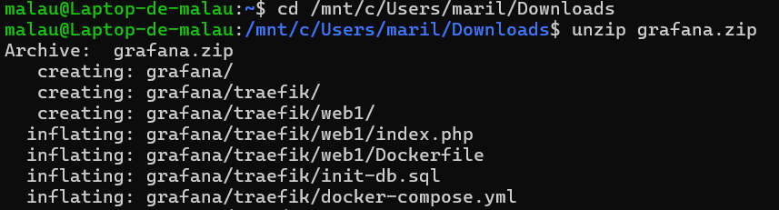

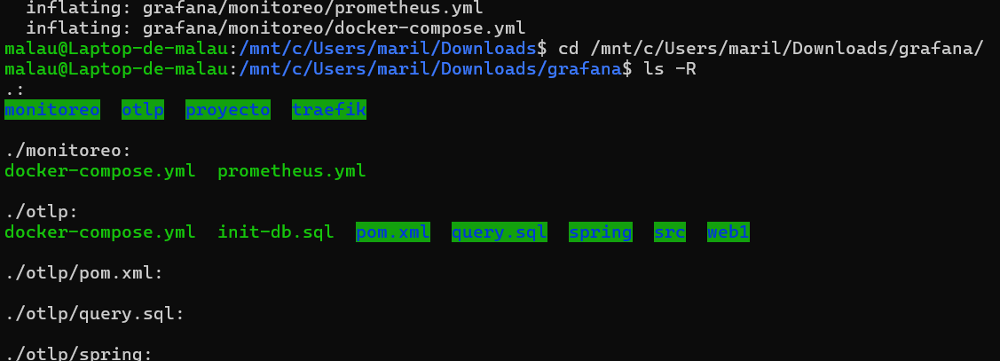

### 5.3 Archivo `docker-compose.yml`

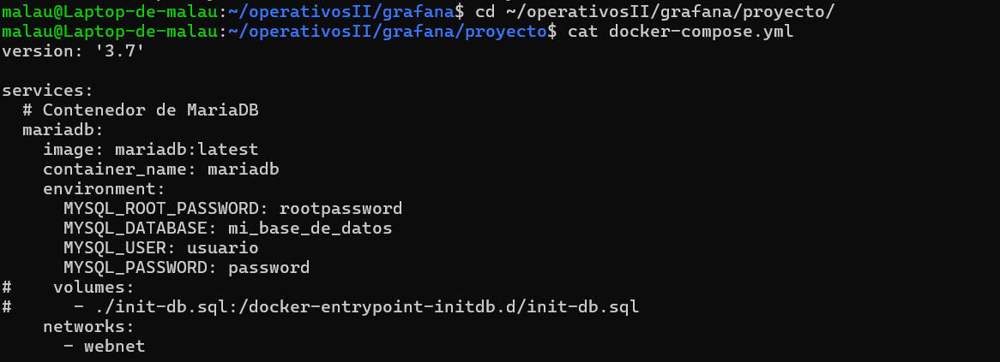

### 5.4 Construcción y despliegue

```bash
docker compose up --build -d
```

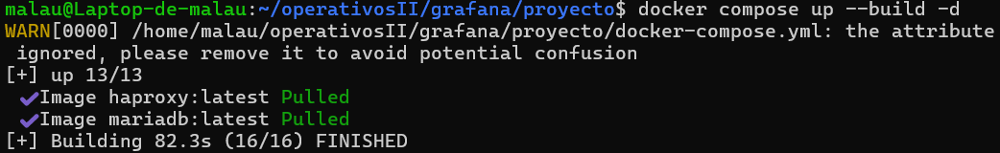

### 5.5 Estado de los servicios y pruebas con `curl`

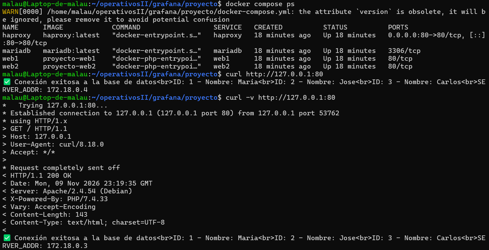

### 5.6 Inspección del contenedor HAProxy

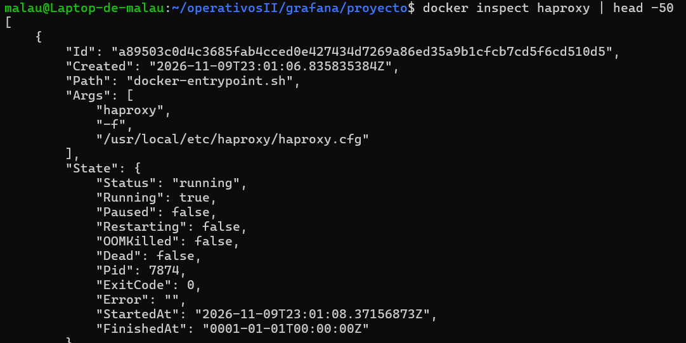

### 5.7 Puertos, procesos y uso de recursos

`docker port haproxy`, `docker top web1`, `docker top mariadb` y `docker stats --no-stream`.

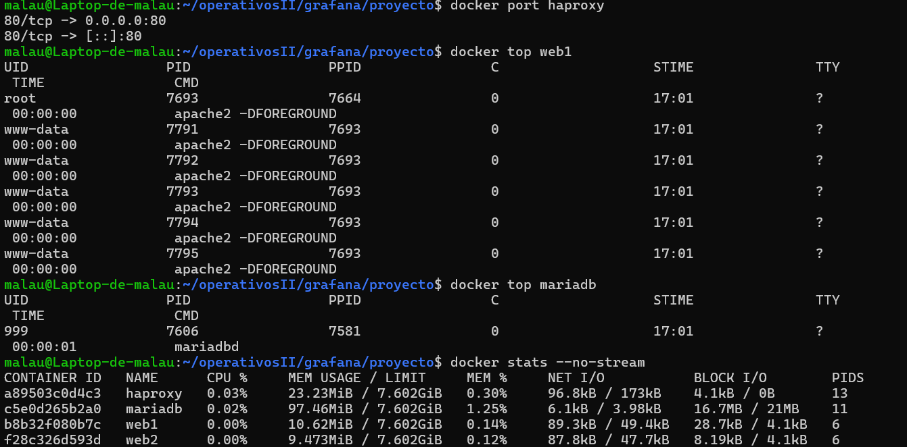

### 5.8 Logs de los contenedores

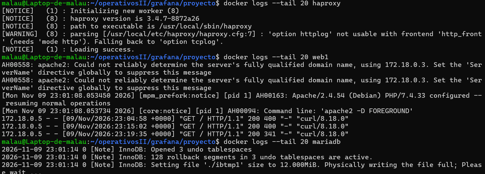

### 5.9 Ejecución de comandos dentro de los contenedores

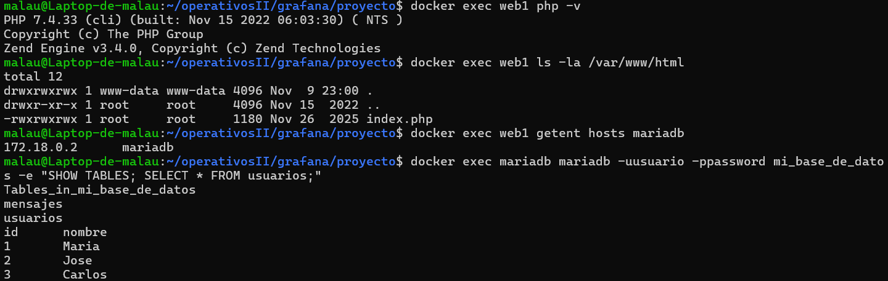

### 5.10 Prueba de balanceo de carga

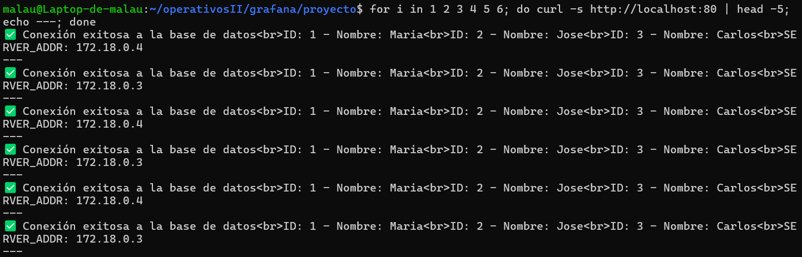

### 5.11 Administración de red

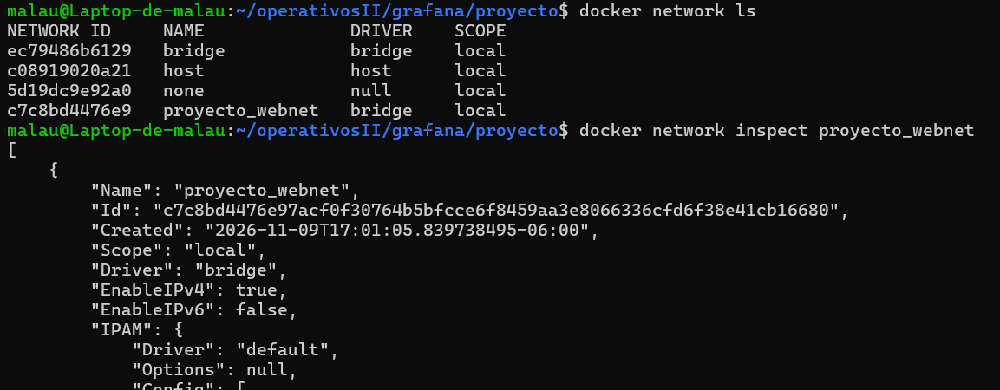

### 5.12 Volúmenes y configuración de HAProxy

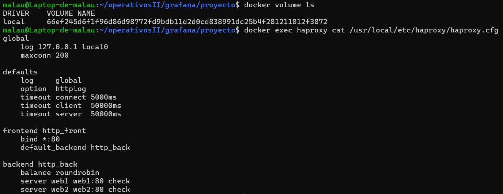

### 5.13 Ciclo de vida de los contenedores

`docker stop web2`, `docker start web2` y `docker restart haproxy`.

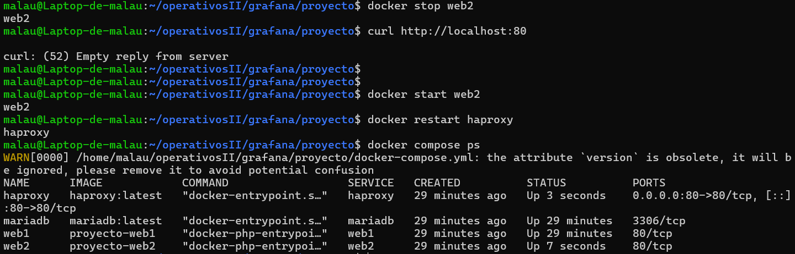

### 5.14 Cierre del entorno

```bash
docker compose down
```

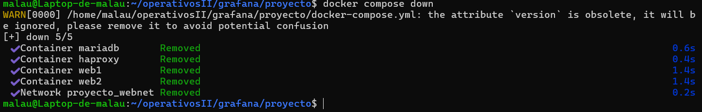
