# Taller #2: WordPress con balanceo de carga, Redis y tolerancia a fallos

**Universidad Latina de Costa Rica** · Sistemas Operativos II

- **Estudiante:** Marialaura Calderón Herrera
- **Docente:** Carlos Andrés Mendez Rodríguez
- **Sede:** San Pedro, San José
- **Fecha:** noviembre, 2026

---

## 1. Preguntas de análisis

**a. ¿Por qué es relevante que `www-data` tenga UID 1003 dentro de ambos contenedores?**
Porque permite que ambos contenedores tengan acceso a los archivos de WordPress con los permisos correctos.

**b. ¿Qué ventaja ofrece ajustar el UID/GID en el `entrypoint` en lugar de incorporarlo como `ARG` de construcción?**
Permite cambiar los permisos al iniciar el contenedor sin tener que reconstruir la imagen.

**c. ¿Qué ocurriría si `web1` utilizara UID 33 y `web2` UID 1003?**
`web1` podría tener problemas de permisos, mientras que `web2` podría acceder correctamente a los archivos.

**d. ¿Por qué Redis Object Cache no es, por sí solo, el responsable de mantener el inicio de sesión nativo de WordPress?**
Porque Redis almacena datos en caché, mientras que WordPress utiliza cookies y claves de autenticación para mantener el inicio de sesión.

**e. ¿Qué datos deben ser idénticos o compartidos para que cualquier réplica valide la cookie de autenticación?**
Las claves y sales de autenticación de WordPress, además de la misma base de datos de usuarios.

**f. ¿Qué diferencia existe entre balanceo de carga y alta disponibilidad?**
El balanceo distribuye las solicitudes entre servidores; la alta disponibilidad busca mantener el servicio funcionando ante fallos.

**g. ¿Por qué esta solución no es completamente tolerante a fallos?**
Porque todavía existen componentes únicos, como MariaDB, Redis y HAProxy, cuya falla puede afectar todo el sistema.

**h. ¿Qué ocurre si falla MariaDB?**
WordPress pierde el acceso a sus datos y las dos réplicas pueden dejar de funcionar correctamente.

**i. ¿Qué ocurre si falla Redis? Distinga entre caché de objetos y sesiones PHP de plugins.**
Se pierde la caché de objetos y puede disminuir el rendimiento. Los plugins que guardan sesiones PHP en Redis también pueden presentar errores.

**j. ¿Qué limitación presenta `/home/orh` si las réplicas se trasladan a hosts distintos?**
Es un directorio local y no se comparte automáticamente entre diferentes equipos.

**k. ¿Qué función cumplen `fall 1` y `rise 2` en HAProxy?**
`fall 1` marca un servidor como caído después de un fallo. `rise 2` lo considera disponible después de dos comprobaciones exitosas.

**l. ¿Por qué no se expone MariaDB ni Redis mediante `ports`?**
Porque solo necesitan comunicarse dentro de la red interna de Docker, sin quedar expuestos al exterior.

**m. ¿Qué riesgo representa que un usuario pertenezca al grupo `docker`?**
Puede administrar contenedores y obtener privilegios equivalentes a los de administrador (root).

**n. ¿Por qué una solicitud que estaba en ejecución podría fallar aunque exista otra réplica?**
Porque HAProxy no siempre puede trasladar una solicitud que ya estaba siendo procesada por el servidor que falló.

**o. ¿Qué componentes deberían duplicarse para eliminar los puntos únicos de fallo?**
MariaDB, Redis y HAProxy, además de contar con almacenamiento compartido y redundante.

**p. ¿Cómo cambiaría este laboratorio al implementarlo en Docker Swarm o Kubernetes?**
Se facilitaría la administración de réplicas, la detección de fallos, el reinicio automático y la distribución de solicitudes.

---

## 2. Evidencias

### 2.1 Usuario del sitio y propietario del directorio

`id orh` y `stat` sobre `/home/orh`.

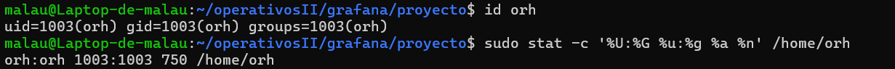

### 2.2 Archivos del proyecto y permisos

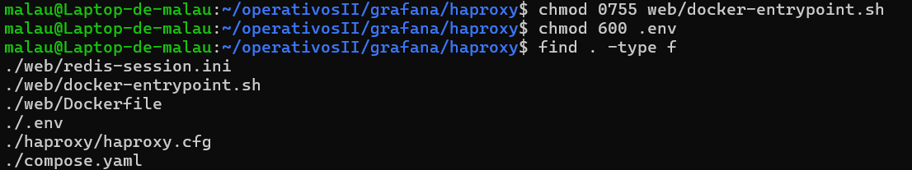

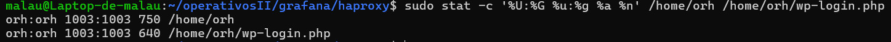

### 2.3 Construcción y despliegue

```bash
docker compose up -d
```

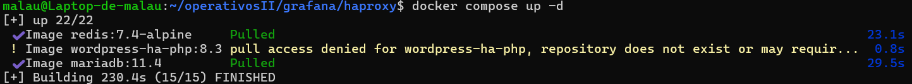

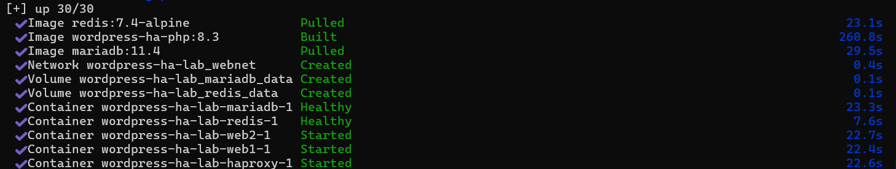

### 2.4 Estado de los servicios y validación de HAProxy

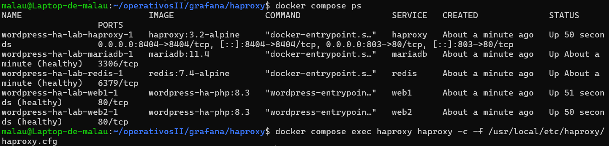

### 2.5 Identidad de `www-data` en ambos contenedores

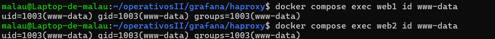

### 2.6 Escritura en el bind mount

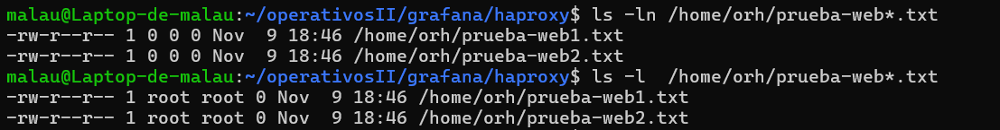

### 2.7 Instalación de WordPress

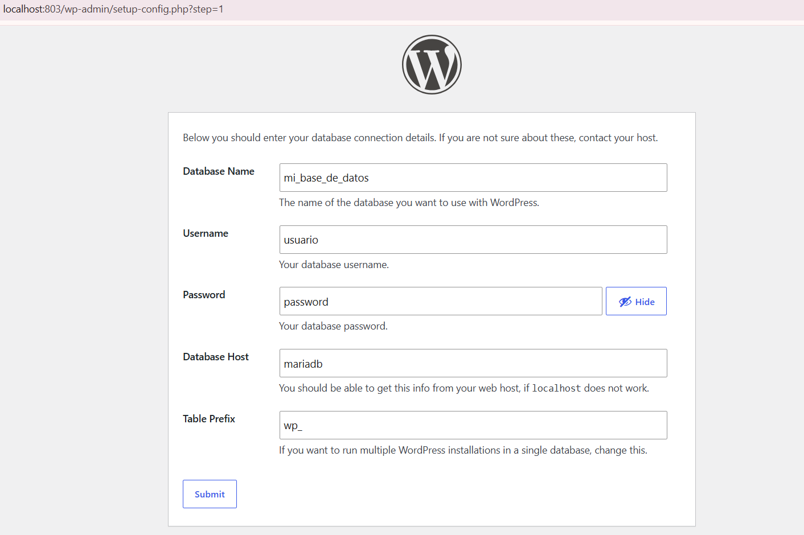

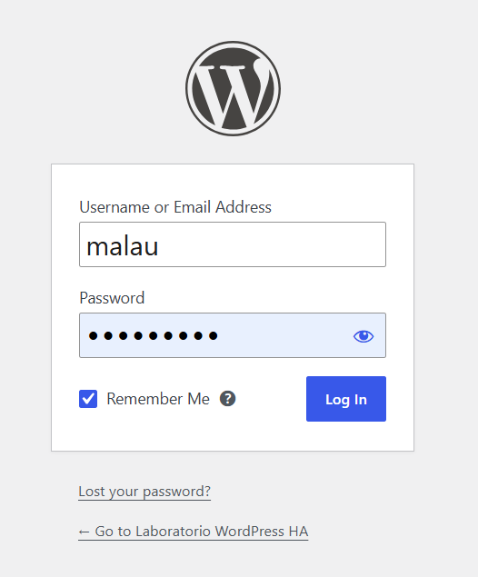

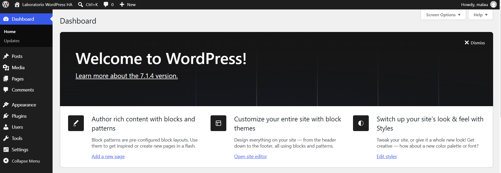

### 2.8 Redis

Extensiones de PHP en ambos backends:

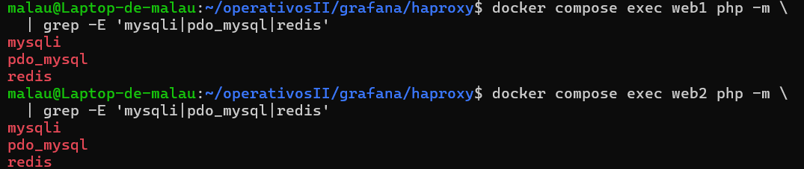

Redis Object Cache conectado:

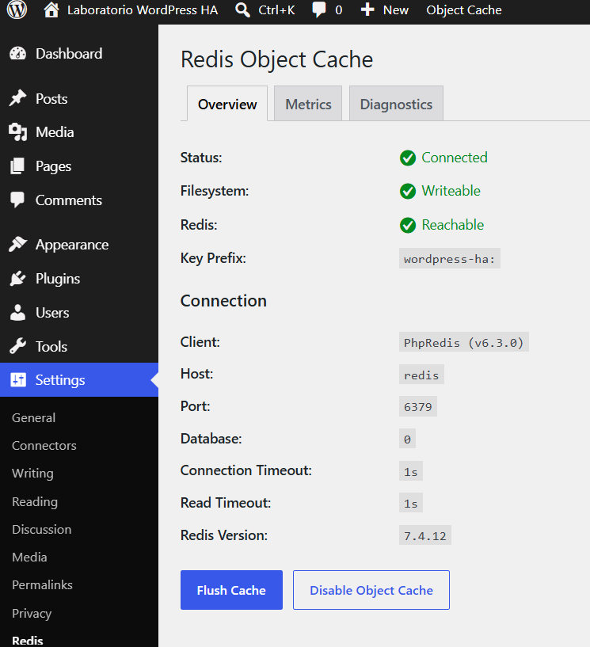

Claves en la base lógica 0:

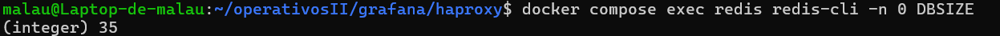

### 2.9 Indicador de backend (must-use plugin)

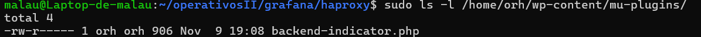

### 2.10 Prueba de balanceo de carga

Diez solicitudes alternando entre `web1` y `web2`:

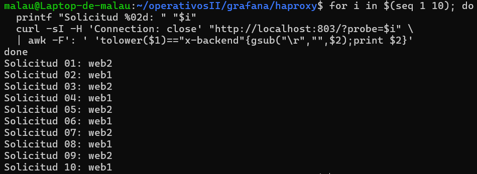

### 2.11 HAProxy con ambos backends UP

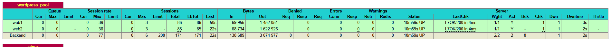

### 2.12 Prueba de fallo de `web1`


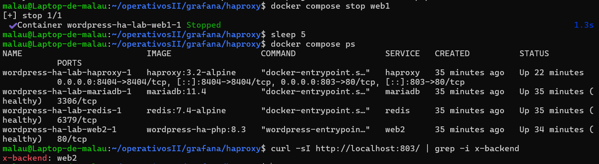

La sesión continúa autenticada, ahora atendida por `web2`:


### 2.13 Prueba de fallo de `web2`

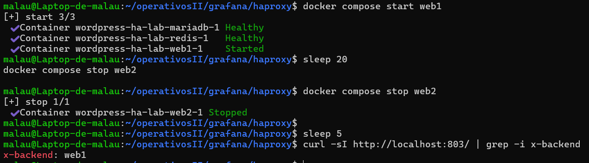

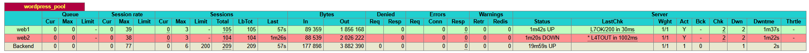

### 2.14 Propiedad de los archivos

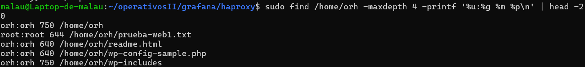

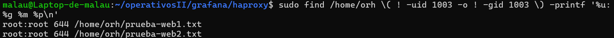
